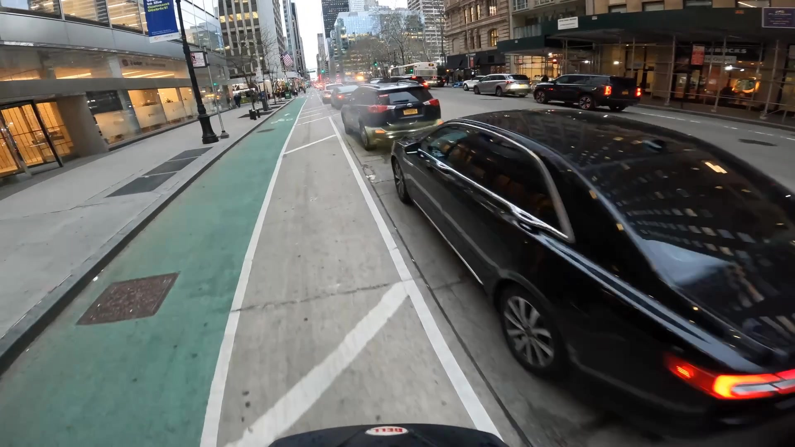
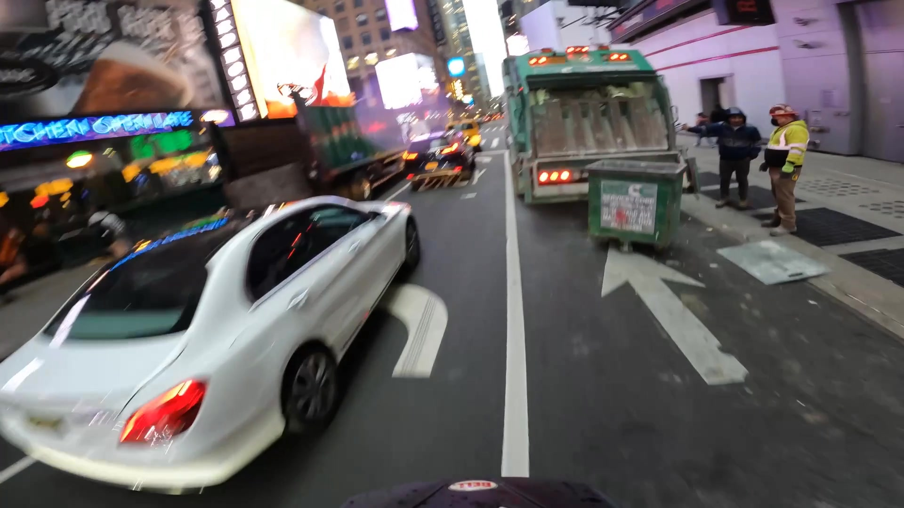
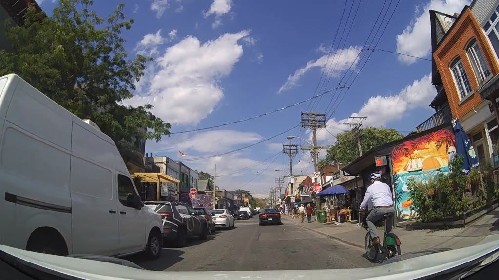
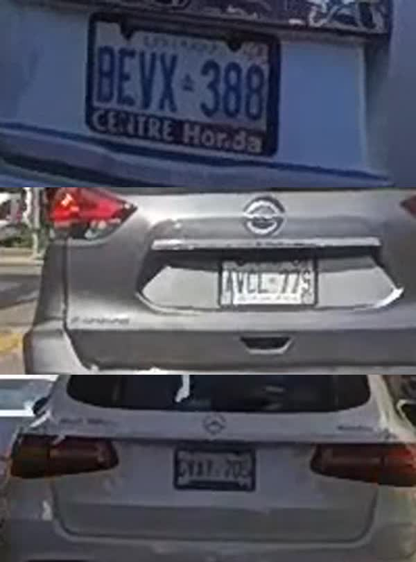
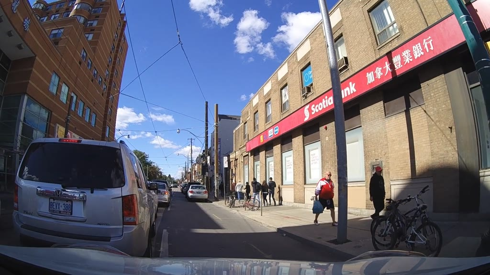

# Initial idea: "Your helmet cam is a witness"

An agent that goes through a cyclist's GoPro footage, finds drivers making unsafe
movements around the cyclist, and prepares a ready-to-submit report for each incident.
The cyclist reviews and approves every report. Nothing is submitted automatically.

## The problem

Cyclists record close passes, cut-ins and blocked bike lanes every day, but almost none of
it gets reported. Going through hours of footage by hand to find the 20 seconds that matter,
then filling in a police form, takes too long. The footage exists; the effort is the barrier.

## What the agent does

1. **Finds incidents.** It scans every segment of a ride for three event types:
   - **Close pass:** a vehicle coming in from the side, filling a large part of the frame, then moving off ahead.
   - **Cut-in:** a vehicle moving sideways across the cyclist's path.
   - **Blocked bike lane:** a vehicle stopped in the bike lane, forcing the cyclist out into traffic.
2. **Ranks them by severity**, using how close the vehicle got and how fast it approached
   (time-to-contact estimated from how quickly its bounding box grows).
3. **Confirms each candidate** by sending two or three frames to the reasoning model
   (Cosmos3-Reason). The model confirms the event type and describes the vehicle. Anything it
   doesn't confirm is dropped.
4. **Writes a report** for each confirmed incident:
   - short clip including the lead-up and aftermath
   - key frames with detection boxes drawn
   - vehicle type, colour and make where visible
   - date, time and severity
   - a short incident summary written by the model
   - blank fields for the plate and street, which the cyclist fills in
   - an export laid out like a police portal's submission form
5. **Hands control to the cyclist.** A review web app lists the incidents with approve, edit
   and dismiss buttons. "Export report" produces a PDF or email draft.

## Example moments from the archive

**Close pass:** a black sedan right beside the rider, with only a painted buffer between them.

**Cut-in:** a white sedan swinging across the rider's line in Times Square.

## What data we have

All bike footage comes from one camera, `nyc_bike_gopro-1`, in New York. No other city has
bike-mounted footage.

| Ride | Segments | Conditions |
|---|---|---|
| GOPR0130 | 180 (about 15 min) | Daytime, heavy Manhattan traffic, following another cyclist |
| GX010001 | 142 (about 12 min) | Dusk, bike lanes, delivery trucks |
| GX050001 | 143 (about 12 min) | Night, green bike lanes |
| **Total** | **465 (about 39 min)** | Roughly half at dusk or night |

For every segment we have:

- **Playable video** through the backend stream endpoint.
- **Detections for every frame:** YOLO11 boxes for car, truck, bus, bicycle and person at 30 frames per second.
- **A written description** from Cosmos3-Reason. 101 of the bike segments mention a bike lane, 76 mention something
  blocking, and many mention taxis, trucks and buses.
- **The reasoning model on demand** for describing specific frames.

## What we tested

- **Approach scoring across all bike segments.** A simple time-to-contact score works but is
  noisy on a moving bike: 154 of 369 segments scored under 1 second, mostly because the bike
  is closing in on parked or stopped cars. The fix is to detect event shapes (side approach,
  sideways movement, stationary in lane) rather than using one score, then confirm with the
  reasoning model.
- **Plate reading.** The reasoning model said "UNREADABLE" for two of three close vehicles,
  which is honest. For the third it returned "1138" when no plate was visible, which is a
  hallucination. It also wrongly said that car was in the bike lane. Conclusion: plates are
  filled in by the cyclist. "The agent never accuses anyone on its own" is part of the pitch.
- **Theft and crash prediction (earlier exploration).** There is no crash footage and no
  theft footage in the archive, so the project is framed as "detects unsafe driving
  behaviour", not "predicts crashes".

## Dashcam footage we can feed in

The archive also has 90 minutes of car dashcam footage from Toronto (`pie_cam-3`). It is the
same kind of incident seen from a car instead of the bike, and it plugs into the same
pipeline: detections, descriptions and the reasoning model work identically on it.

| Camera | Location | Segments | Cyclists? |
|---|---|---|---|
| `pie_cam-3` | Toronto, car dashcam, 6 drives (`set01` to `set06`) | 1,080 (about 90 min) | Yes: 119 descriptions describe an actual cyclist; YOLO sees a bicycle in 514 segments |
| `i24_cam-1` | Nashville, fixed highway camera | 180 | None. Highway lane changes only, not useful for this idea |

**What we found:**

- **Detections alone over-count cyclists.** Many "bicycle" detections are parked bikes on the
  sidewalk. Requiring a person riding the bike (a person box sitting on top of the bicycle
  box) for at least 10 frames cuts this down to **130 segments with a ridden cyclist**.
- **24 of those segments have another vehicle within half a bike-width of the cyclist**, at
  the same distance from the camera. These are candidate third-party close passes witnessed by
  the dashcam. They still need checking by eye or with the reasoning model.
- **Dashcams show plates much better than the helmet cam.** From the dashcam, rear plates
  of the cars ahead are usually readable by a person. The reasoning model read one of three
  correctly (`BEVX 388`) and misread the other two, so plates still need a human to confirm,
  but the agent can now crop the plate and put it in the report.

A typical false positive the "ridden cyclist" rule removes (parked bikes next to the curb):

**How the dashcam feeds the idea:**

1. **Second witness.** The same detector runs on dashcam footage, so a close pass can be
   captured by the cyclist's camera, a following car's dashcam, or both. This could be pitched as
   a "witness network": any road user's camera can contribute evidence.
2. **Better plate evidence.** Dashcam frames give a plate crop the cyclist or reviewer can
   confirm, which the helmet cam rarely provides.
3. **More data for the demo.** 90 more minutes in a second city, covering daytime streets,
   bike lanes, streetcars and parked delivery vans.

## Constraints and how we handle them

| Constraint | How we handle it |
|---|---|
| Plates not reliably readable | Cyclist enters the plate; the agent picks the frames most likely to show it and crops the plate (best from dashcam footage) |
| No GPS in the metadata | Date, time and city come from the data; the cyclist adds the street |
| No crash ground truth | Framed as unsafe-behaviour detection, not crash prediction |
| Night footage | Ranking still works on detections; descriptions flag low-light segments |
| Police submission rules | Reports follow portal requirements; the cyclist approves and submits |

## Where reports could go

- **UK:** the National Dash Cam Safety Portal accepts helmet-cam and dashcam footage.
- **New York:** blocked bike lanes are reported through 311.

These portals typically require the original unedited footage, date, time and location, and a
signed statement from the person who filmed it, usually within about 14 days. That is why the
agent prepares the pack and the cyclist submits it. For the demo, the "Send" button goes to a
dummy endpoint or a prefilled email.

## Build plan

1. **Incident detector.** Event-shape rules over the detections for all 465 bike segments, plus the
   "ridden cyclist with a vehicle alongside" rule over the 1,080 Toronto dashcam segments; output a ranked list of incidents.
2. **Model confirmation.** Frames for each candidate go to Cosmos3-Reason for structured confirmation and a vehicle description.
3. **Report generator.** Clip, annotated frames, summary, and submission-form layout.
4. **Review web app.** Deployed at `/app` on the team URL: ride view, incident list, approve, edit or dismiss, then export.

Steps 1 and 2 drive the quality, so they come first, with the ranked incidents reviewed
before the app is built.

## Pitch line

"Your helmet cam is a witness. The agent watches the ride, finds the drivers who put you at
risk, and hands you a report ready to submit. You decide what gets sent."
