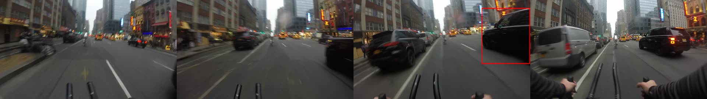
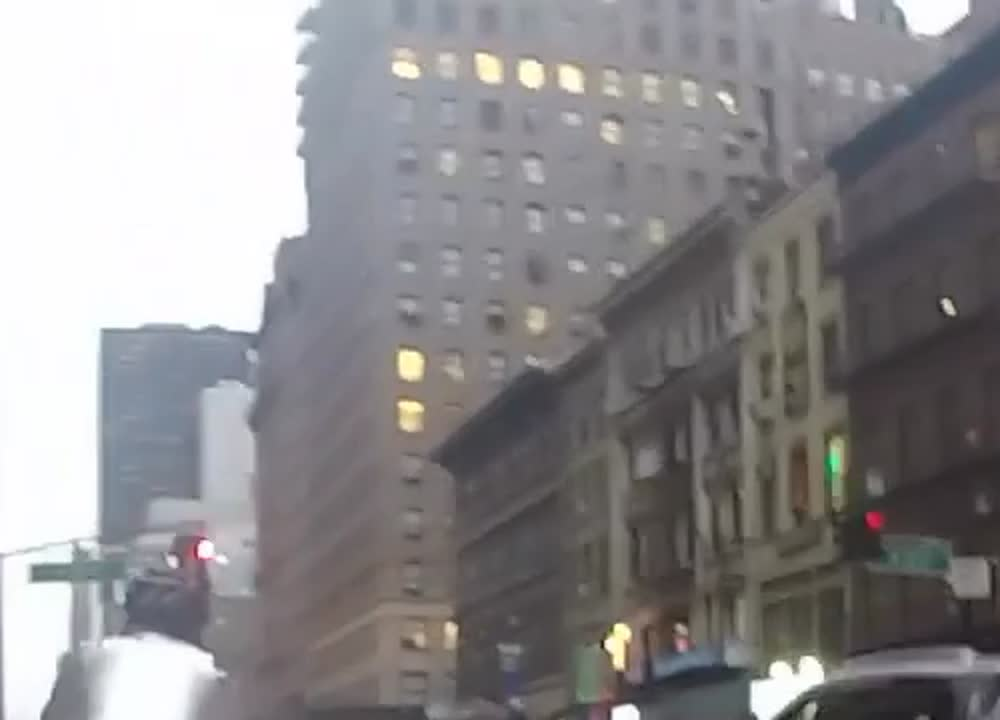

# Witness: your helmet cam is a witness, and a coach

VAST Builders Challenge, London, Sat 17 Oct 2026.

Cyclists record close passes every day, and almost none get reported: finding the 5 seconds that matter
in an hour of footage and filling in a police form takes too long. And nobody tells riders about the
risks they take themselves.

Witness is designed for the cyclist to check their own safety. It watches their ride footage, finds every
risky moment, and works out who caused it, so they can review a report or a lesson before anything leaves
the app. The live front page is titled **Cyclist Safety**.

The rides loaded here are assumed to be one user's footage: three NYC helmet-cam rides from their cameras.
More devices can be registered. **Register device** stores another camera id on this user's rides (demo only;
it stays in the app).

| Who was at fault | What the agent writes | Who sees it |
|---|---|---|
| Driver | **Authority report**: police-form fields, clip, vehicle, blank plate and street for the cyclist to fill in | Police / 311 / insurer, **only if the cyclist exports it** (Send is a dummy outbox) |
| Rider | **Rider lesson**: what happened, why it was risky, what to do next time | The cyclist only. Never sent anywhere |
| Unclear | Both a report and a lesson | Listed on **Reports to send** and **Lessons for you**. The cyclist decides |
| Parked car | **Parking report**: a vehicle stopped in the bike lane, with the ID read off the crops shown as evidence | The cyclist. Same export path as a driver report; not a near-miss accusation |

**Try it:** the App button on workshop.thecosmoslabs.com (`/app`). Open a ride. The ride page has three tabs —
**Reports to send** (driver and unclear), **Lessons for you** (rider and unclear), and **Parked cars**.
Open an incident: the clip plays with the detection boxes drawn over it, stills mark the evidence times,
the facts behind the verdict are listed, and you can approve, edit, dismiss or change the fault
(including to Parked car). Previous and next move along the ride. Then open the report or lesson.
A review overrides the engine verdict, and those reviews are kept in `data/reviews.json`.

The home page also links to **Register device**, **About / how it works** (the label score for this load),
and a timeline of how every segment was screened.




## How it works: the models see, the rules decide

```
465 helmet-cam segments (3 NYC rides, VAST DataEngine index)
  │
  ├─ A  Cosmos3-Reason watches every 5 s clip (1280 px, 6 fps)  ─ near miss? signal? rider position?
  ├─ B  YOLO11 boxes from the pipeline → geometry               ─ how close, which side, entered the rider's corridor?
  ├─ C  Cosmos again on A ∪ B flags, 5 calls, majority vote     ─ + full-resolution still for the signal
  ├─ D  Plain-Python fault rules (no LLM)                       ─ driver / rider / unclear, plus severity
  ├─ E  W&B Inference (gpt-oss-120b) writes the report or lesson from the facts
  ├─ F  Cosmos on the bike lane, then YOLO crops for vehicle ID ─ parked in the bike lane (rule 9)
  └─ G  Coach: rider-fault incidents grouped by habit in Python; W&B Inference writes, a critic call checks
        │
        └─ data/incidents.json → stdlib web app on K8s (/app); video and boxes proxied from the VSS backend
```

- **Cosmos is good at context and fault** (the signal, the rider on the sidewalk, what happened) and at
  rejecting false alarms, but it is conservative about distance.
- **YOLO is good at distance and side**, but it can't tell a car in the next lane from a car cutting in.
- **So a driver verdict needs both:** a YOLO close-pass shape **and** at least 4 of 5 Cosmos calls saying
  the vehicle entered the rider's path, with no separator, no red signal and the rider not on the sidewalk.
  Missing or unknown facts never produce a driver verdict. A wrong "driver" puts a false accusation in front
  of the police, so it is the error we try hardest to avoid.
- Rider rules run first: entered on red (video **and** still), riding on the sidewalk, changing line into traffic.
- Cosmos's own `fault` answer is stored for comparison and never used.
- **Parked is its own case, not a driver verdict.** Stage F keeps a vehicle only when the Cosmos checks agree
  it is stopped in a visible bike lane. Consecutive segments of the same vehicle are one incident.
  The number read from the crops is evidence for the cyclist to check. It is not copied into the plate field,
  because a blurry crop can look like a fleet number or a wrong plate.

## Results

On the clips checked by eye (`probe/labels.csv`, plus reviews recorded in the app, scored in `data/incidents.json`):
**12 of 19 agree with the label, and no rider, adjacent-lane or separated clip gets a driver verdict**
(`wrong_driver` 0, rules v6). Two of those 19 were labelled by reviews in the app.
All five hero clips match: H1 and H4 driver, H3 rider (entered on red, 5/5 votes), H5 rider (sidewalk),
H2 (a van in the next lane) dropped.

Across all 465 segments: **105 incidents (12 driver, 25 rider, 45 unclear, 23 parked)**.
W&B wrote the report or lesson text on 82 of them. The 23 parked reports are a title only.
**Coach report** (`engine/coach.py`, the W&B Report "Your riding coach"): the 25 rider incidents come down to
3 habits, entering junctions on red (14), riding on the sidewalk (10) and changing line into traffic (1), each
with a pattern, what to practise and a cue. Python does all the counting; the writer's text passes hard checks
(no numbers, no legal claims) and a critic call (no unsafe advice, nothing invented, a one-off is not a habit).
The critic was added after an early draft told the rider to go on red once nothing was "within about a metre".

How the near-miss definition was tuned, round by round: [PLAN.md](PLAN.md) ("Near-miss definition") and
[definition_log.md](definition_log.md).

## Honest limits

- Closeness is estimated from box size, not measured distance.
- Tuned and scored on a small hand-labelled set (19 clips in the current score), not a benchmark.
- Most driver verdicts outside the hero clips have not been checked by eye yet; the cyclist reviews every one.
- Cosmos is unreliable about vehicle colour, so colour and plate are always left for the cyclist to confirm.
- A number read off a parked vehicle can be a fleet or taxi number. It stays in the evidence, not the plate box.
- The archive has no recording date or GPS; reports say "cyclist to confirm".
- No face blurring in exported frames yet.

## Built on

VAST DataEngine + VastDB (index, YOLO detections, video), NVIDIA Cosmos3-Reason (screening, fault facts, bike-lane check),
YOLO11 (geometry and vehicle crops), W&B Inference `openai/gpt-oss-120b` (report, lesson and coach text), W&B Weave (traces of every Cosmos and
LLM call, label evaluation per rules version, versioned coach report) and W&B Reports, Kubernetes on the VAST
runtime, Cursor and Claude Code.

## Repo

| Path | What |
|---|---|
| `engine/detect.py` | Stage B: YOLO geometry |
| `engine/confirm.py` | Stage C: Cosmos confirmation with majority vote |
| `engine/fault.py`, `engine/build_incidents.py` | Stage D: fault rules, severity, `data/incidents.json` |
| `engine/report.py` | Stage E: W&B writes the reports and lessons |
| `engine/coach.py` | Stage G: the rider coaching report (data/coach.md, W&B Report "Your riding coach") |
| `engine/wb_trace.py`, `engine/wandb_sync.py` | Weave tracing; incidents, labels and the rules evaluation to W&B |
| `engine/bikelane.py` | Stage F: vehicles stopped in the bike lane, plus vehicle ID |
| `app/main.py` | Web app (stdlib `http.server`): rides, three tabs, incident review, report, lesson, devices, timeline |
| `k8s/` | `deploy-app.sh` (deploy to `/app`; pulls reviews first), `update-data.sh` (push new data) |
| `probe/` | Exploration, labelled set, evaluation |
| `PLAN.md` | Full plan, fault rules, prompts and changelog |

The app reads `data/incidents.json` (in the cluster, `/data/incidents.json`). A cyclist's review is stored
separately and can override the fault the rules wrote. Rebuild and publish: see [engine/README.md](engine/README.md).

## Team

Duncan Alexander
Esa Khamis
Olivia Guo
