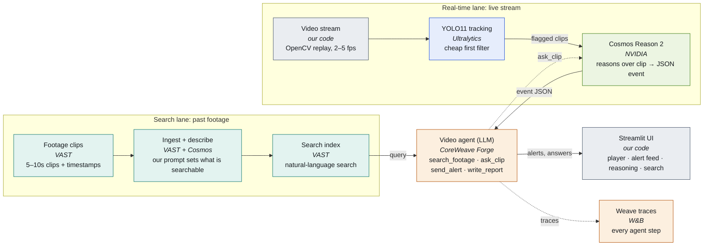

# Real-Time Video Agent Stack

**VAST Builders Challenge · London · Sat 17 Oct**

Two lanes feed one agent. The **search lane** makes past footage queryable. The **real-time lane** uses YOLO to filter cheaply and Cosmos to reason about only the clips YOLO flags. The agent decides what to do and the UI shows it.



## Components

| Layer | Tool | Provided by | Role |
|---|---|---|---|
| Storage + ingestion | VAST build environment | VAST | Stores clips and makes descriptions with our custom prompt |
| Semantic search | VAST video search | VAST | Natural-language search over clip descriptions |
| Real-time detection | YOLO11 (`yolo11n` / `yolo11s`) | Ultralytics | Detects and tracks objects frame by frame; cheap first filter |
| Video understanding | Cosmos Reason 2 (2B for speed, 8B for quality) | NVIDIA | Reasons over flagged clips and returns a JSON event |
| Agent / LLM | Serverless Inference | CoreWeave Forge (W&B) | Plain Python tool-calling loop using the OpenAI client |
| Tracing | Weave / Agent Lens | W&B | Shows every agent step |
| UI | Streamlit | Our code | Video player, alert feed, Cosmos reasoning, search box |
| Coding | Cursor | Cursor | Event credits |

## Agent tools

| Tool | Calls |
|---|---|
| `search_footage(q)` | VAST search index |
| `ask_clip(clip, q)` | Cosmos Reason 2 |
| `send_alert(event)` | UI alert feed |
| `write_report()` | Incident summary |

Cosmos's `recommended_agent` field picks which tool runs next.

## JSON contract

Agree this early so both lanes can be built in parallel.

```json
{
  "event": "no_hard_hat",
  "confidence": "high",
  "severity": "warning",
  "clip_id": "cam2_00412",
  "t_start": 132.0,
  "t_end": 138.0,
  "reasoning": "Worker on scaffold, bare head...",
  "recommended_agent": "send_alert"
}
```

## Rules for the day

- Pick **one specific use case** after seeing the footage, e.g. "flag someone missing a hard hat".
- **Write the ingest prompt first.** Search only finds what the clip descriptions mention.
- YOLO runs on every frame. Cosmos runs **only on clips YOLO flags**.
- If Cosmos is slow, use fewer frames, shorter clips, or the 2B model.
- Stop adding features at **3:30**, record the demo video by **4:00**, submit by **4:30**.

## Submission checklist

- [ ] GitHub repo accessible to reviewers
- [ ] Short demo video with a shareable link
- [ ] What we built + tools used
- [ ] Team names and contact emails
- [ ] Optional: screenshot or a working site
